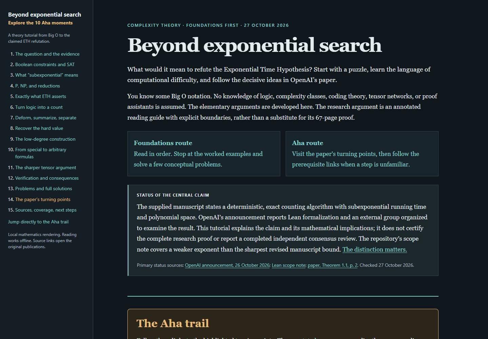
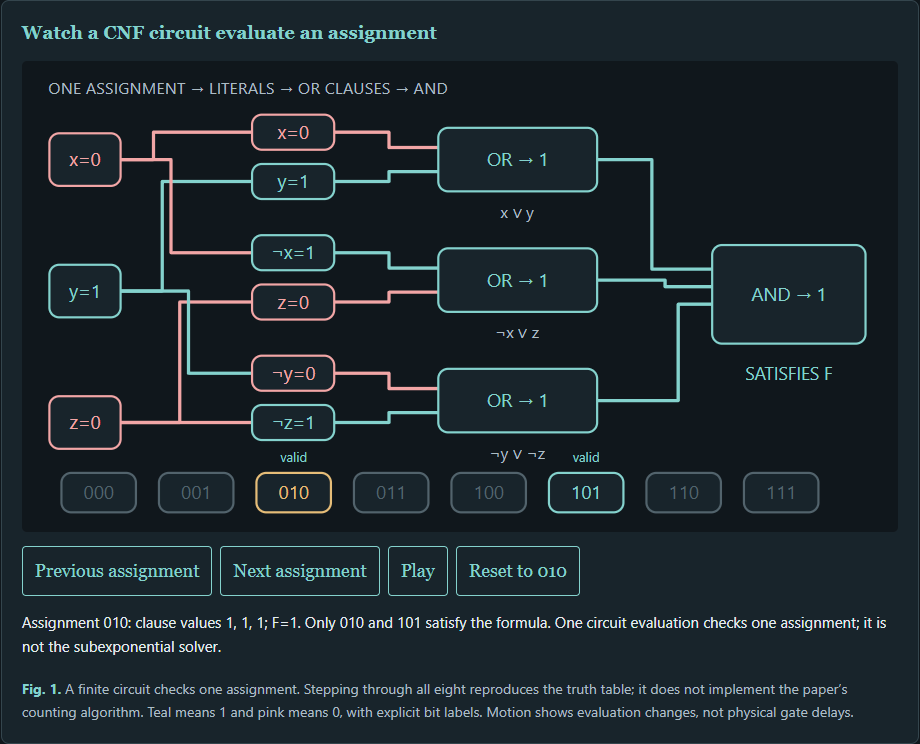

# ETH is false — Aha moments

**[Read the live dark-mode tutorial](https://az9713.github.io/ETH-is-false-aha-moments/)** · **[Jump to the Aha trail](https://az9713.github.io/ETH-is-false-aha-moments/#aha-guide)** · [Print edition](tutorial/evidence/tutorial-print.pdf)

Click the preview to open the live GitHub Pages site. GitHub README pages display
this linked preview; the HTML itself runs on GitHub Pages.

A foundations-first guide for a reader who knows some Big O notation and is new
to complexity theory. It develops Boolean satisfiability, P versus NP, ETH,
exact counting, algebraic deformation, shared summaries, interpolation, and the
key steps in OpenAI's October 2026 claimed refutation. Eighteen conceptual
problems include full solutions. Hands-on experiments are deferred.

## Visual explanations

Eight diagrams and step-through views make the abstract arguments visible.
They start paused, provide keyboard controls, respect reduced motion, and have
static SVG fallbacks. On a phone, wide diagrams scroll within their panels.

| Visual | What it explains |
|---|---|
| [CNF logic circuit](https://az9713.github.io/ETH-is-false-aha-moments/#visual-circuit) | Bits pass through literals, OR clauses, and the final AND. All eight assignments reproduce the truth table. |
| [Effective exponent rates](https://az9713.github.io/ETH-is-false-aha-moments/#visual-growth) | A smaller positive exponential rate differs from a rate that tends to zero. |
| [Shared summaries](https://az9713.github.io/ETH-is-false-aha-moments/#visual-summaries) | Fixing an interface separates local choices without losing their multiplicities. |
| [Hermite recovery](https://az9713.github.io/ETH-is-false-aha-moments/#visual-hermite) | Value and slope can leave ambiguity; enough Taylor data determine the missing target value. |
| [Spectral window](https://az9713.github.io/ETH-is-false-aha-moments/#visual-spectral) | Widening the interpolation interval reduces exceptional directions at the cost of polynomial degree. |
| [Greedy parity filtering](https://az9713.github.io/ETH-is-false-aha-moments/#visual-parity) | Compare total survivor counts to remove false positives without knowing the true count. |
| [Tensor network and recursion budget](https://az9713.github.io/ETH-is-false-aha-moments/#visual-tensor) | Equality tables preserve variable identity; the separate recursion bound has geometrically shrinking exponent costs. |
| [Why the claimed result refutes ETH](https://az9713.github.io/ETH-is-false-aha-moments/#visual-refutation) | Connect a counter for every 3-CNF, exactness, complete cost accounting, and positivity to the contradiction with ETH. Research proof obligations are explicitly marked. |

These are checked finite teaching constructions and labeled proof diagrams,
not a reproduction or benchmark of the research algorithm. Plot geometry uses
the D3 bundle from [az9713/animate-libs](https://github.com/az9713/animate-libs);
the page uses SVG and native browser animation, with no remote runtime dependencies.

## The Aha moments

Each link opens the exact highlighted passage in the live tutorial.

| Moment | What becomes clear |
|---|---|
| [1. Candidates are not a lower bound](https://az9713.github.io/ETH-is-false-aha-moments/#aha-candidates) | Having 2ⁿ possible assignments does not prove every algorithm must visit them. |
| [2. Polynomial reductions can destroy the saving](https://az9713.github.io/ETH-is-false-aha-moments/#aha-blowup) | A subexponential SAT algorithm need not give a subexponential algorithm for every NP problem. |
| [3. ETH false does not settle P versus NP](https://az9713.github.io/ETH-is-false-aha-moments/#aha-barrier) | Removing an exponential barrier establishes neither a polynomial upper bound nor a superpolynomial lower bound. |
| [4. Count without listing](https://az9713.github.io/ETH-is-false-aha-moments/#aha-count) | The exact number of solutions needs at most n + 1 output bits, even when there are exponentially many solutions. |
| [5. Separate through a small interface](https://az9713.github.io/ETH-is-false-aha-moments/#aha-separation) | Fixing bounded shared measurements makes transformed groups factor into smaller sums. |
| [6. Taylor order limits the corrections](https://az9713.github.io/ETH-is-false-aha-moments/#aha-taylor) | Low-order information can be recovered using only small correction subsets and exact cancellation. |
| [7. One polynomial serves two constraints](https://az9713.github.io/ETH-is-false-aha-moments/#aha-matrix) | Spectral concentration and low-degree interpolation make locality compatible with few measurements. |
| [8. The qualitative refutation appears earlier](https://az9713.github.io/ETH-is-false-aha-moments/#aha-enough) | Section 2.8 removes the special-input restrictions with a weaker bound that is already subexponential. |
| [9. Counting constructs the filter](https://az9713.github.io/ETH-is-false-aha-moments/#aha-greedy) | A sparse-system counter chooses parity tests without knowing the true satisfying-assignment count. |
| [10. Divisibility and recursion sharpen the bound](https://az9713.github.io/ETH-is-false-aha-moments/#aha-tensor) | High-weight interactions vanish modulo the working precision; remaining contractions shrink. |

For precise theorem, equation, and page locators, use the
**[annotated paper map](https://az9713.github.io/ETH-is-false-aha-moments/#paper-map)**.
The **[three-cost ledger](https://az9713.github.io/ETH-is-false-aha-moments/#three-costs)**
shows where the claimed running time becomes subexponential; the
**[refutation chain](https://az9713.github.io/ETH-is-false-aha-moments/#refutation-chain)**
shows why that guarantee would contradict ETH.

## Sources

### Papers and primary verification material

- **OpenAI, _The Exponential Time Hypothesis is False_**, dated 17 October,
  revised 25 October 2026 — [manuscript](https://raw.githubusercontent.com/openai/math/main/preprints/The-Exponential-Time-Hypothesis-is-False-October-25-2026/paper.pdf).
  The supplied 67-page PDF is the main mathematical source. Its bytes were
  matched to the dated public copy when preparing the tutorial.
- **Scott Aaronson, _P ?= NP_**, survey of the field in 2017 —
  [author's 122-page PDF](https://www.scottaaronson.com/papers/pnp.pdf).
  Supplies definitions, reductions, counting, historical ETH context, and
  algorithms-to-lower-bounds background. Historical frontier claims stay historical.
- **OpenAI, “Working with academic communities to build scientific understanding,”
  26 October 2026** — [announcement](https://openai.com/index/building-scientific-understanding-with-academic-communities/).
  The supplied `ETH.png` is an excerpt of this announcement; the original image
  stays local.
- **OpenAI's formalization scope** —
  [scope note](https://github.com/openai/math/blob/main/lean/docs/378.md),
  [comparator target](https://github.com/openai/math/blob/main/lean/ComparatorChallenges/SubexponentialSAT.lean),
  [comparison configuration](https://github.com/openai/math/blob/main/lean/ComparatorChallenges/SubexponentialSAT.json),
  and [separate solution entry point](https://github.com/openai/math/blob/main/lean/OAI/Algorithms/SubexponentialSAT/Main.lean).
  The tutorial distinguishes the scope note's exponent from the sharper revised
  manuscript bounds. No local Lean build or complete proof audit is claimed.

### Video commentary

- **Samuel Allen Alexander** — [YouTube video](https://www.youtube.com/watch?v=ZbxC0412cys).
  The supplied Samuel transcript covers comparison of the announcements, a
  reading of the paper introductions, reduction-size issues, and asymptotic
  versus practical efficiency. Useful entry points:
  [OpenAI paper discussion, 07:49](https://www.youtube.com/watch?v=ZbxC0412cys&t=469s),
  [reduction-size warning, 16:08](https://www.youtube.com/watch?v=ZbxC0412cys&t=968s),
  [practical limits, 26:36](https://www.youtube.com/watch?v=ZbxC0412cys&t=1596s).
- **Wes Roth** — [YouTube video](https://www.youtube.com/watch?v=3Edjn34IuzQ).
  The supplied transcript provides the initial motivation and analogies.
  The tutorial includes a
  [timestamped correction ledger](https://az9713.github.io/ETH-is-false-aha-moments/#transcript-corrections)
  for distinctions that the commentary compresses or gets wrong.

The video labels identify their creators and links, rather than claiming
independently verified video titles. Full supplied transcripts were read as
text; no complete audiovisual review is claimed. Commentary about priority,
other research results, or immediate practical effects is not promoted to a
verified theorem. The empty supplied `README.txt` has no substantive content.
**Every `*.txt` file is excluded from Git and publication.**

## Scope and verification

This is an independent teaching guide, not a certification of the research
proof. It separates elementary arguments proved here, checked teaching examples,
cited research theorems, and publisher-reported formalization status.

The core explanation received an independent scientific-editor pass. Exact
teaching identities and offline desktop/mobile rendering were checked. The
repository includes the [source ledger](source-manifest.json),
[claim map](analysis-ir.json), [per-source notes](tutorial/evidence/source-notes.md),
and [browser-check output](tutorial/evidence/browser-checks.json).
All 34 finite visualization states and SVG bounds are checked in the
[visual verification output](tutorial/evidence/visual-checks.json).

Open `index.html` locally for the dark-mode reader. MathJax is bundled, so the
tutorial text and mathematics work offline; links to original sources require
internet access. The generated print edition uses a paper-friendly appearance.
The third-party renderer's license is in [tutorial/mathjax-LICENSE](tutorial/mathjax-LICENSE).
